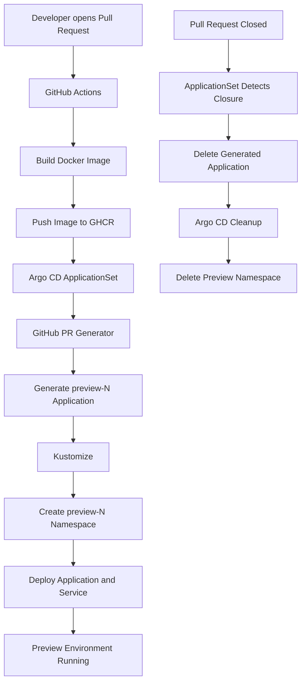
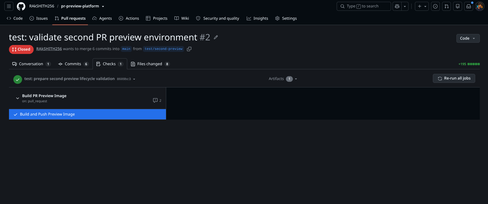
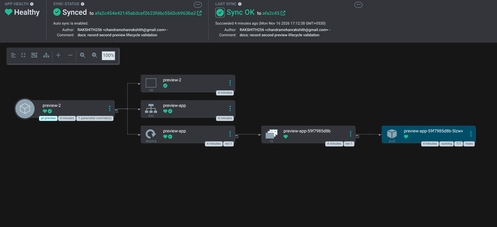
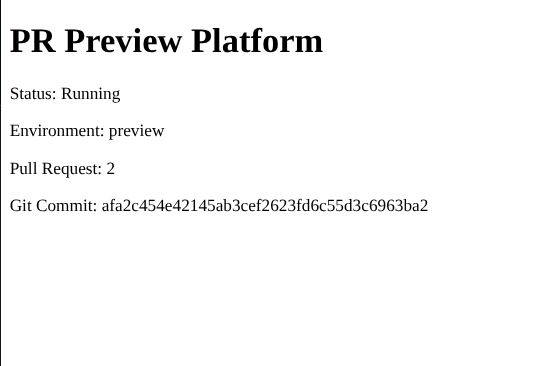
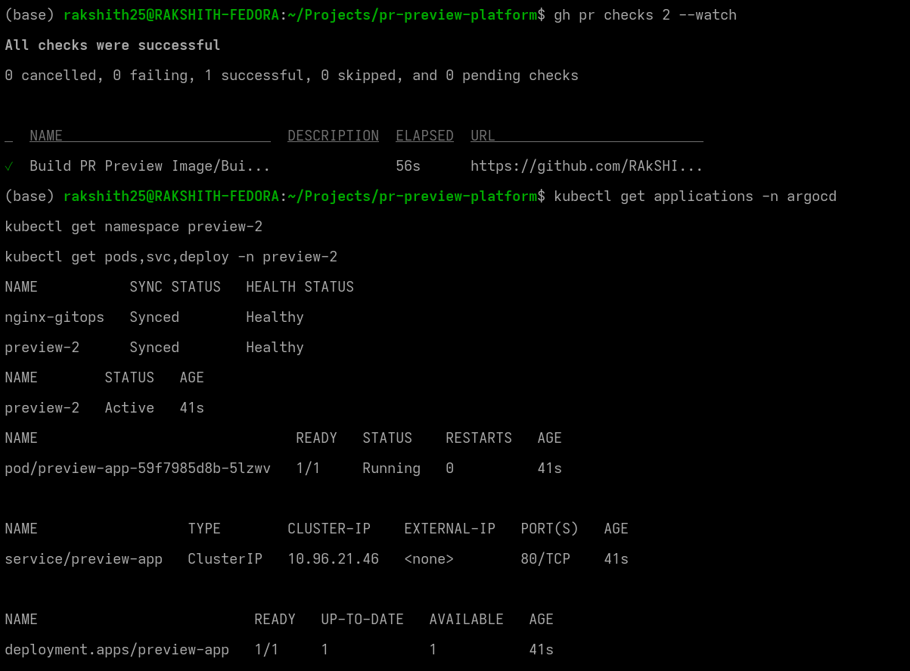

# PR Preview Platform

**Automated ephemeral Kubernetes environments for every GitHub Pull Request.**

A GitOps-driven platform that automatically builds, deploys, and manages isolated preview environments for pull requests. Each PR gets its own Kubernetes namespace and application deployment. When the PR closes, its preview environment is automatically removed.

## Architecture



## Screenshots

### GitHub Actions – Image Build


### Argo CD – Preview Application


### Running Preview Environment


### Automatic Cleanup


## Technology Stack

- **Containerization:** Docker
- **Orchestration:** Kubernetes, kind
- **GitOps:** Argo CD, ApplicationSet
- **CI/CD:** GitHub Actions
- **Container Registry:** GitHub Container Registry (GHCR)
- **Configuration Management:** Kustomize
- **Application:** Go

## Key Features

- Automated Docker image builds for pull requests.
- Isolated Kubernetes namespace for every open PR.
- Dynamic preview application generation using Argo CD ApplicationSet.
- Automated synchronization and deployment.
- Automatic environment cleanup when a PR closes.
- Health and version endpoints for deployment verification.

## Validation

Successfully tested two complete PR preview lifecycles.

| Validation | Result |
|---|---|
| GitHub Actions image build | Passed |
| Preview deployment for PR #1 | Passed |
| Preview deployment for PR #2 | Passed |
| Application health and version endpoints | Passed |
| Automatic namespace cleanup | Passed |
| Existing GitOps application preserved | Passed |

Detailed evidence: [`docs/validation-evidence.md`](docs/validation-evidence.md).

## Project Structure

```text
pr-preview-platform/
├── .github/workflows/
├── app/
├── argocd/
├── k8s/
│   ├── base/
│   └── preview/
├── docs/
│   ├── screenshots/
│   └── validation-evidence.md
├── Dockerfile
└── README.md
```

## Project Outcome

Built and validated an automated PR preview platform using Kubernetes and GitOps, demonstrating dynamic environment provisioning, continuous deployment, and automatic resource cleanup.
